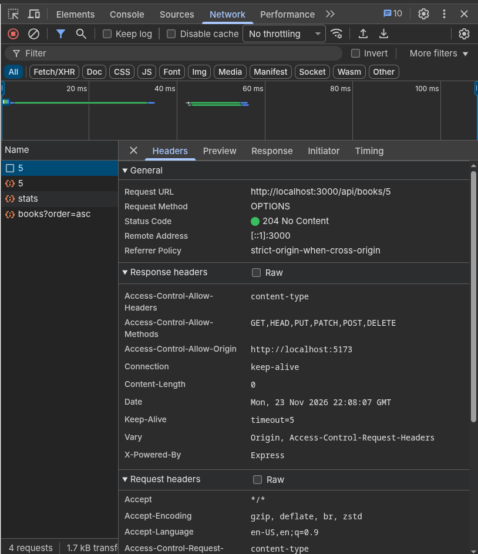

# CMP309 - Assignment 9

## File Organization

```text
/assignment9
 ├─ server/
 │   ├─ server.js           —> server entry point
 │   ├─ booksStore.js       —> book store and manipulation
 │   ├─ validate.js         —> validation scripts for id, query and books
 │   ├─ package.json        
 │   └─ package-lock.json
 ├─ client/
 │   ├─ src/
 │   │   ├─ api/books.js    —> backend api hooks
 │   │   ├─ components/     —> React components
 │   │   ├─ App.jsx         —> application 
 │   │   └─ main.jsx        —> main entry
 │   ├─ .env.example        —> example .env
 │   ├─ index.html
 │   └─ package.json
 └─ .gitignore
```

## How to run

Requirements: Node.js (current lts)

- Server (port 3000)

```bash
cd server
npm install
cp .env.example .env
npm run dev
```

- Client (port 5173)

```bash
cd client
npm install
cp .env.example .env
npm run dev
```

Then open `http://localhost:5173`

| Variable | Where | Default | Meaning |
| --- | --- | --- | --- |
| PORT | Server | 3000 | The port api listens on |
| CLIENT_ORIGIN | Server | http://localhost:5173 | Allowed origins by CORS |
| VITE_API_URL | Client | none (set in .env) | API base url (e.g. http://localhost:3000/api)

## Reasoning Questions

- **Q1:** id is a route parameter because it identifies a resource (e.g. a book `/api/books/2`), genre and sort aren't route parameters because they don't identify a resource, they filter through the collection of books. if id was in the query string `/api/books?id=1` would point at the whole book collection.
- **Q2:** after moving `express.json()` middleware at the bottom, `req.body` became undefined in the POST handler, and it returned `400` with `{"error":"body must be a JSON object"}`
- **Q3:** removed `return` from the early `404` in `GET /api/books/:id`. Client still received the correct status and respone, but server console showed errors about http errors being already sent (`ERR_HTTP_HEADERS_SENT`). `res.status(404).json(...)` doesn't stop execution after itself so a second respone is tried to be sent after it.
- **Q4:** PATCH is better when small changes are done like setting the read status or changing rating. Client will only send `{ "read": true }` or `{ "rating": 4 }`, server will keep everything else, sending a PUT with an incomplete body would reset the not included fields. PUT is better then editing the whole book, server replaces the book in memory with the whole body and resets every left-out field to their default values.
- **Q5:** set the `CLIENT_ORIGIN` to `http://localhost:5174` while the client still remained on `http://localhost:5173`, browser console showed a CORS error saying `Access-Control-Allow-Origin` header did not match the requesting origin and fetches failed with `net::ERR_FAILED`. But since CORS is enforced by the browser, and curl doesn't check the CORS headers, it just prints the result to terminal.

```text
Access to fetch at 'http://localhost:3000/api/stats' from origin 'http://localhost:5173' has been blocked by CORS policy: The 'Access-Control-Allow-Origin' header has a value 'http://localhost:5174' that is not equal to the supplied origin. Have the server send the header with a valid value.
books.js:10 
 GET http://localhost:3000/api/stats net::ERR_FAILED 200 (OK)
App.jsx:92 Failed to fetch
(index):1 Access to fetch at 'http://localhost:3000/api/books?order=asc' from origin 'http://localhost:5173' has been blocked by CORS policy: The 'Access-Control-Allow-Origin' header has a value 'http://localhost:5174' that is not equal to the supplied origin. Have the server send the header with a valid value.
books.js:10 
 GET http://localhost:3000/api/books?order=asc net::ERR_FAILED 200 (OK)
```

```bash
curl localhost:3000/api/books/1  
{"id":1,"title":"The Hunger Games","author":"Suzanne Collins","year":2008,"genre":"fiction","read":false,"rating":null}
```

- **Q6:** Client-side checks do not provide real security as it can be modified or bypass entirely via DevTools or a command line tool like curl. So the server can't trust what it receives.
- **Q7:** All data about the books were reset to their initial state, this means they were living in the node process' memory and wiped as soon as the node process restarted. To make this permanent they need to be stored on a non-volatile storage medium instead of the ram, like via a database.

## Testing Evidence (curl)

```bash
curl -i "localhost:3000/api/books?genre=fiction&sort=year&order=desc"
```

```http
HTTP/1.1 200 OK
X-Powered-By: Express
Access-Control-Allow-Origin: http://localhost:5173
Vary: Origin
Content-Type: application/json; charset=utf-8
Content-Length: 223
ETag: W/"df-ThTFihpfUSK17MtP8SzgCwNM5M0"
Date: Mon, 23 Nov 2026 21:52:22 GMT
Connection: keep-alive
Keep-Alive: timeout=5

[{"id":1,"title":"The Hunger Games","author":"Suzanne Collins","year":2008,"genre":"fiction","read":false,"rating":null},{"id":2,"title":"Dune","author":"Frank Herbert","year":1965,"genre":"fiction","read":true,"rating":5}]
```

```bash
curl -i localhost:3000/api/books/2
```

```http
HTTP/1.1 200 OK
X-Powered-By: Express
Access-Control-Allow-Origin: http://localhost:5173
Vary: Origin
Content-Type: application/json; charset=utf-8
Content-Length: 101
ETag: W/"65-p8FMTUy/XHr0MEm4VB/wOyYKQ7E"
Date: Mon, 23 Nov 2026 21:54:15 GMT
Connection: keep-alive
Keep-Alive: timeout=5

{"id":2,"title":"Dune","author":"Frank Herbert","year":1965,"genre":"fiction","read":true,"rating":5}
```

```bash
curl -i -X POST localhost:3000/api/books -H "Content-Type: application/json" -d '{"title":"Neuromancer","author":"William Gibson","year":1984,"genre":"fiction"}'
```

```http
HTTP/1.1 201 Created
X-Powered-By: Express
Access-Control-Allow-Origin: http://localhost:5173
Vary: Origin
Location: /api/books/7
Content-Type: application/json; charset=utf-8
Content-Length: 113
ETag: W/"71-BLtfXgaNXSqFBT19nZ2yyNOPPTs"
Date: Mon, 23 Nov 2026 21:54:55 GMT
Connection: keep-alive
Keep-Alive: timeout=5

{"id":7,"title":"Neuromancer","author":"William Gibson","year":1984,"genre":"fiction","read":false,"rating":null}
```

```bash
curl -i -X POST localhost:3000/api/books -H "Content-Type: application/json" -d '{"title":"","author":"X","year":3000,"genre":"nope"}'
```

```http
curl -i -X POST localhost:3000/api/books -H "Content-Type: application/json" -d '{"title":"","author":"X","year":3000,"genre":"nope"}'
HTTP/1.1 400 Bad Request
X-Powered-By: Express
Access-Control-Allow-Origin: http://localhost:5173
Vary: Origin
Content-Type: application/json; charset=utf-8
Content-Length: 45
ETag: W/"2d-PXqHF3FOrFmCsvBXYC5IUu7v7ko"
Date: Mon, 23 Nov 2026 21:55:21 GMT
Connection: keep-alive
Keep-Alive: timeout=5

{"error":"title must be 1 to 100 characters"}
```

```bash
curl -i "localhost:3000/api/books?genre=fiction&genre=history"
```

```http
HTTP/1.1 400 Bad Request
X-Powered-By: Express
Access-Control-Allow-Origin: http://localhost:5173
Vary: Origin
Content-Type: application/json; charset=utf-8
Content-Length: 38
ETag: W/"26-lxepMkDRVvPlaLI1MymRjo2aMRU"
Date: Mon, 23 Nov 2026 21:55:43 GMT
Connection: keep-alive
Keep-Alive: timeout=5

{"error":"genre must not be repeated"}
```

```bash
curl -i localhost:3000/api/books/999
```

```http
HTTP/1.1 404 Not Found
X-Powered-By: Express
Access-Control-Allow-Origin: http://localhost:5173
Vary: Origin
Content-Type: application/json; charset=utf-8
Content-Length: 34
ETag: W/"22-Y4vPsZnpJGAWgn7/BJeTo9GoF8s"
Date: Mon, 23 Nov 2026 21:56:19 GMT
Connection: keep-alive
Keep-Alive: timeout=5

{"error":"Book id does not exist"}
```

```bash
curl -i -X POST localhost:3000/api/books -H "Content-Type: application/json" -d '{"title":"Neuromancer","author":"William Gibson","year":1984,"genre":"fiction"}'
```

```http
HTTP/1.1 409 Conflict
X-Powered-By: Express
Access-Control-Allow-Origin: http://localhost:5173
Vary: Origin
Content-Type: application/json; charset=utf-8
Content-Length: 60
ETag: W/"3c-1rKybwsDvqZ/tq/34Gi1BUJi6S8"
Date: Mon, 23 Nov 2026 21:56:43 GMT
Connection: keep-alive
Keep-Alive: timeout=5

{"error":"a book with this title and author already exists"}
```

```bash
curl -i localhost:3000/api/stats
```

```http
HTTP/1.1 200 OK
X-Powered-By: Express
Access-Control-Allow-Origin: http://localhost:5173
Vary: Origin
Content-Type: application/json; charset=utf-8
Content-Length: 127
ETag: W/"7f-G1Pyu8uDQMmt1y1R4g3w7Kvo3FA"
Date: Mon, 23 Nov 2026 21:57:06 GMT
Connection: keep-alive
Keep-Alive: timeout=5

{"total":7,"read":3,"unread":4,"averageRating":4.7,"byGenre":{"fiction":3,"history":1,"science":1,"fantasy":1,"non-fiction":1}}
```

```bash
curl -i -X DELETE localhost:3000/api/books/3
```

```http
HTTP/1.1 204 No Content
X-Powered-By: Express
Access-Control-Allow-Origin: http://localhost:5173
Vary: Origin
Date: Mon, 23 Nov 2026 21:57:35 GMT
Connection: keep-alive
Keep-Alive: timeout=5
```

```bash
curl -i localhost:3000/api/stats
```

```http
HTTP/1.1 200 OK
X-Powered-By: Express
Access-Control-Allow-Origin: http://localhost:5173
Vary: Origin
Content-Type: application/json; charset=utf-8
Content-Length: 113
ETag: W/"71-1GPz+hdy8gFYovsjKddlIW12Plk"
Date: Mon, 23 Nov 2026 21:58:09 GMT
Connection: keep-alive
Keep-Alive: timeout=5

{"total":6,"read":2,"unread":4,"averageRating":5,"byGenre":{"fiction":3,"science":1,"fantasy":1,"non-fiction":1}}
```

```bash
curl -i -X PATCH localhost:3000/api/books/1 -H "Content-Type: application/json" -d '{"read":true,"rating":4}'
```

```http
HTTP/1.1 200 OK
X-Powered-By: Express
Access-Control-Allow-Origin: http://localhost:5173
Vary: Origin
Content-Type: application/json; charset=utf-8
Content-Length: 115
ETag: W/"73-frnE4Fo0OAEpAlZh/6D8XJ987Vk"
Date: Mon, 23 Nov 2026 22:04:36 GMT
Connection: keep-alive
Keep-Alive: timeout=5

{"id":1,"title":"The Hunger Games","author":"Suzanne Collins","year":2008,"genre":"fiction","read":true,"rating":4}
```

```bash
curl -i -X PUT localhost:3000/api/books/1 -H "Content-Type: application/json" -d '{"title":"The Hunger Games","author":"Suzanne Collins","year":2008,"genre":"fiction"}'
```

```http
HTTP/1.1 200 OK
X-Powered-By: Express
Access-Control-Allow-Origin: http://localhost:5173
Vary: Origin
Content-Type: application/json; charset=utf-8
Content-Length: 119
ETag: W/"77-RUh2qPc25lqGuIOq2Rqh5Tj50a0"
Date: Mon, 23 Nov 2026 22:05:06 GMT
Connection: keep-alive
Keep-Alive: timeout=5

{"id":1,"title":"The Hunger Games","author":"Suzanne Collins","year":2008,"genre":"fiction","read":false,"rating":null}
```

```bash
curl -i -X DELETE localhost:3000/api/books/1
curl -i -X DELETE localhost:3000/api/books/1
```

```http
HTTP/1.1 204 No Content
X-Powered-By: Express
Access-Control-Allow-Origin: http://localhost:5173
Vary: Origin
Date: Mon, 23 Nov 2026 22:05:44 GMT
Connection: keep-alive
Keep-Alive: timeout=5

HTTP/1.1 404 Not Found
X-Powered-By: Express
Access-Control-Allow-Origin: http://localhost:5173
Vary: Origin
Content-Type: application/json; charset=utf-8
Content-Length: 34
ETag: W/"22-Y4vPsZnpJGAWgn7/BJeTo9GoF8s"
Date: Mon, 23 Nov 2026 22:05:44 GMT
Connection: keep-alive
Keep-Alive: timeout=5

{"error":"Book id does not exist"}
```



## Self-Study

- **URLSearchParams:** a built-in tool that builds the ?a=1&b=2 part of a URL for me. It also escapes weird characters like spaces and &, so they can’t break the URL. I use it in listBooks, and I skip empty filters so they aren’t sent.
- **localeCompare:** compares two strings alphabetically. It returns a negative number, 0 or a positive number, which is what sort needs. It handles capital letters and accents better than <. I use it to sort by title and author.
- **import.meta.env:** how Vite lets browser code read .env values. Only names starting with VITE_ are exposed, so secrets don’t leak by accident. I use VITE_API_URL for the server address, and restart Vite after changing it.
- **204:** means “success, nothing to send back”. The server uses res.status(204).end() with no body. The client returns null for a 204, because reading JSON from an empty response would crash.
- **AbortController:** lets me cancel a fetch that is no longer needed. When a filter changes, the old request is cancelled, so its late answer can’t overwrite the newer one. A cancelled fetch throws an error named AbortError, which I ignore because it isn’t a real failure.

## Challenges Faced

- Missing return after an early 404, which sent two responses and logged ERR_HTTP_HEADERS_SENT
- getBookById used filter, which returns an array that is always truthy, so the 404 never fired (switched to find)
- Validating repeated query params, which Express delivers as arrays
- Keeping PUT and PATCH different: PATCH merges with the existing book before validating, PUT validates only the body
- Leftover variable names after switching to useReducer, plus a missing fields parameter in handleSave
